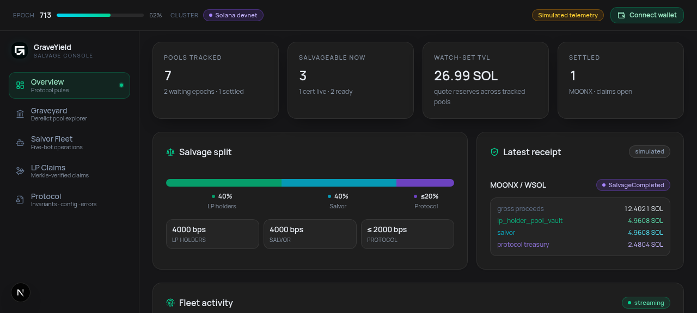
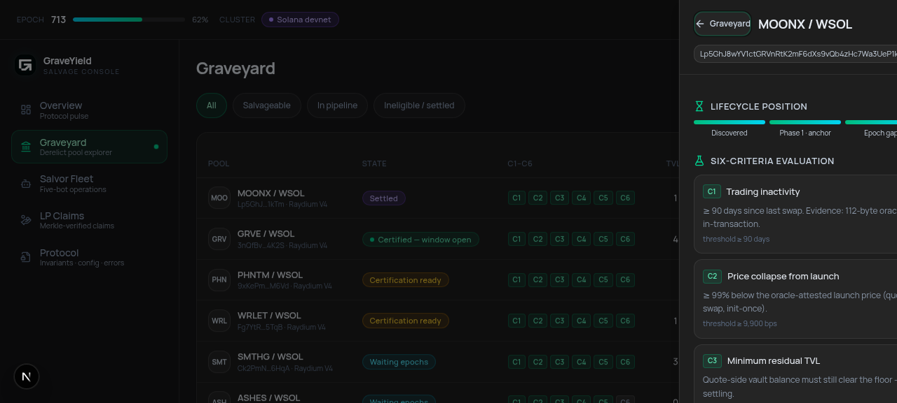

# GraveYield — Salvage Console

Operations console for the **GraveYield protocol** — certify and salvage derelict Solana LP pools.

GraveYield finds liquidity pools that have been abandoned by their communities, certifies them against an on-chain charter, and lets independent salvors recover the trapped liquidity under a fixed settlement split. This repository is the console UI that operators and salvors use to watch the graveyard, evaluate candidates, and drive the salvage flow.



## What's inside

Five views, one route:

| View | Purpose |
| --- | --- |
| **Overview** | Protocol pulse — **live** devnet reads of both deployed programs and their `ProtocolConfig` PDAs, plus KPI cards and a fleet activity feed that remain **simulated fixtures**. |
| **Graveyard** | Derelict pool explorer over **real indexer data** — the `grave-indexer console-snapshot` artifact is served by `/api/gy/snapshot` from a configured source and parsed by a fail-closed loader with per-pool provenance (sha256 account fingerprint, fetch timestamps) and a 24 h freshness budget. Four explicit artifact states — fresh / stale / unavailable / corrupt — with manual refresh (no polling). Search, state filters, sortable table (TVL / idle / collapse / score). Each pool opens a detail sheet with lifecycle position, six-criteria states, and the salvage estimator. |
| **Salvor Fleet** | The five-bot operations fleet (scout · conservative · sniper · experimental · monitor) with its standing runbook — **simulated**; live fleet-state ingestion is not built yet. |
| **LP Claims** | Merkle-verified claim lookup — **simulated**; real snapshot and on-chain claim integration is not built yet. |
| **Protocol** | Charter invariants register, deployed program IDs, config defaults, PDA map, and a full error decoder (6000–6034, 7000–7022). |



## Salvage, briefly

A pool only becomes salvageable after passing **six criteria (C1–C6)** — trading inactivity, price collapse from launch, minimum residual TVL, unburned LP supply, no locked LP, and multi-epoch confirmation. Certification is two-phase: an on-chain anchor, an epoch confirmation gap, then a certificate with a **1-hour TTL** during which the salvage window is open.

Settlement is fixed on-chain: **40% LP holders · 40% salvor · ≤20% protocol treasury**. The built-in estimator is integer-exact (same arithmetic as the fleet-core off-chain estimator) — it walks direct WSOL withdrawal, the memecoin→WSOL leg with dust handling, slippage floors, and full cost accounting down to break-even.

## Real wallet, honest per-view data

The console connects to **real Solana wallets** via the Wallet Standard (Phantom, Solflare, Backpack, and any compatible wallet are auto-detected — no adapter packages required). Connecting shows your devnet SOL balance and links out to Solana Explorer.

Data honesty is per-view and labeled in the UI:

- **Graveyard pool rows are real**: a `ConsoleSnapshotV1` artifact produced by [`grave-indexer`](https://github.com/GraveYield/grave-indexer) `console-snapshot` (currently 12 of 118 supported WSOL pairs enriched) is delivered to the console through the `/api/gy/snapshot` route and parsed by a fail-closed loader that rejects malformed records, fabricates nothing, renders missing activity as *unavailable* (never zero), and marks the artifact stale after its 24 h freshness budget. The route supports two source topologies — `GY_SNAPSHOT_URL` (HTTPS artifact store; how serverless deploys obtain indexer output without assuming a persistent local directory) and `GY_SNAPSHOT_PATH` (indexer output volume; self-hosted) — and answers with an explicit four-state envelope: **valid / stale / missing / corrupt**. Stale artifacts are served but labeled; missing and corrupt ones serve no payload at all. Every payload is re-validated client-side through the same fail-closed parser. Refresh is **manual only** — the console never polls the indexer. See [`docs/snapshot-transport.md`](docs/snapshot-transport.md).
- **The protocol pulse is live**: raw devnet JSON-RPC reads of both deployed programs and their `ProtocolConfig` PDAs, Anchor-discriminator-checked with byte-pinned decoders.
- **Everything else stays simulated on purpose**: overview KPIs and the fleet feed, the fleet view, the claims view, and all transaction actions are fixtures or dry-run toasts — this app never builds, signs, or submits a transaction today.

## Tech stack

- **Next.js 16** (App Router) · **React 19** · **TypeScript**
- **Tailwind CSS** + shadcn/ui (Radix primitives) — dark-first flat neutral theme, Inter
- **@solana/web3.js** + **@solana/wallet-adapter-react** (Wallet Standard detection, devnet RPC)
- **Bun** as the package manager and runtime

## Getting started

```bash
# requires bun >= 1.1
bun install
bun run dev        # → http://localhost:3000
```

Optional: point the wallet connection at your own RPC by setting `NEXT_PUBLIC_SOLANA_RPC_URL` (defaults to the public devnet cluster).

Optional: configure the snapshot artifact source (none is set by default — with no source the Graveyard honestly renders *unavailable* instead of pretending):

```bash
# serverless (Vercel etc.): HTTPS artifact store URL of console-snapshot.json
GY_SNAPSHOT_URL="https://artifacts.example/gy/console-snapshot.json"

# self-hosted: path to the indexer's output file on a mounted volume
GY_SNAPSHOT_PATH="/var/lib/grave-indexer/console-snapshot.json"
```

See [docs/snapshot-transport.md](docs/snapshot-transport.md) for the artifact delivery runbook.

```bash
bun run lint       # eslint
bun run test       # unit battery (bun test): estimator economics, criteria thresholds,
                   # snapshot artifact contract + transport (stale/invalid never fresh),
                   # program-ID pins, display formatters
bun run build      # production build (typecheck enforced)
```

## Project structure

```
src/
├── app/
│   ├── api/gy/snapshot/  # artifact transport route (GY_SNAPSHOT_URL | GY_SNAPSHOT_PATH)
│   └── ...               # single-route console + providers
├── components/
│   ├── gy/               # GraveYield views (overview, graveyard, fleet, claims, protocol) + shell/widgets
│   └── ui/               # shadcn/ui primitives
└── lib/
    └── gy/               # domain: types · snapshot contract (isomorphic fail-closed parser) ·
                          # transport envelope + client hydration gate · source resolver
                          # (path/url, four-state) · committed artifact (contract test seed) ·
                          # protocolLive (live devnet config reads) · estimator (integer-exact
                          # fleet-core port) · simulated fixtures · display formatters ·
                          # __tests__ battery
```

## Related repositories

- [`graveyield-protocol`](https://github.com/GraveYield/graveyield-protocol) — Anchor programs (GraveScanner / GraveVault), canonical SDK, indexer, snapshotter
- [`grave-indexer`](https://github.com/GraveYield/grave-indexer) — pool discovery + oracle evidence pipeline; produces the console's `ConsoleSnapshotV1` artifact
- [`salvor-bots`](https://github.com/GraveYield/salvor-bots) — the five-bot salvor fleet and fleet-core estimator
- [`graveyield-site`](https://github.com/GraveYield/graveyield-site) — public landing site

## Status

**Research preview.** Devnet only — no mainnet deployment, unaudited. Graveyard rows are real indexer observations (staleness is badged, never hidden); fleet, claims, and overview KPIs remain simulated fixtures, and no transaction path exists in the app. Terminology is normative: pools are *derelict*, recovery is *salvage*, and the operators are *salvors*.
